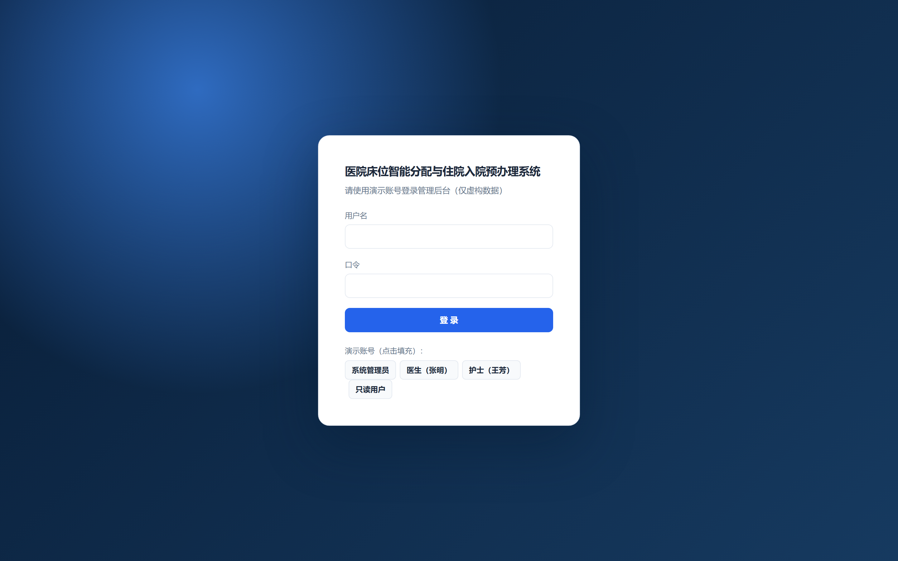
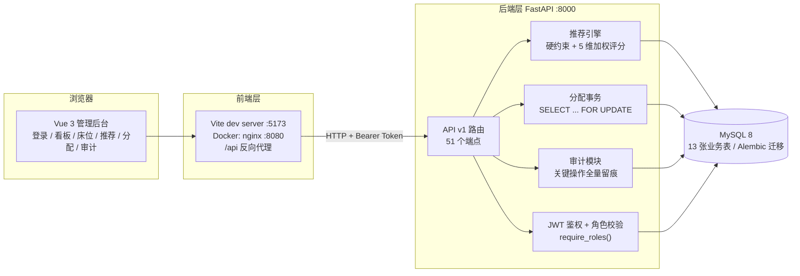
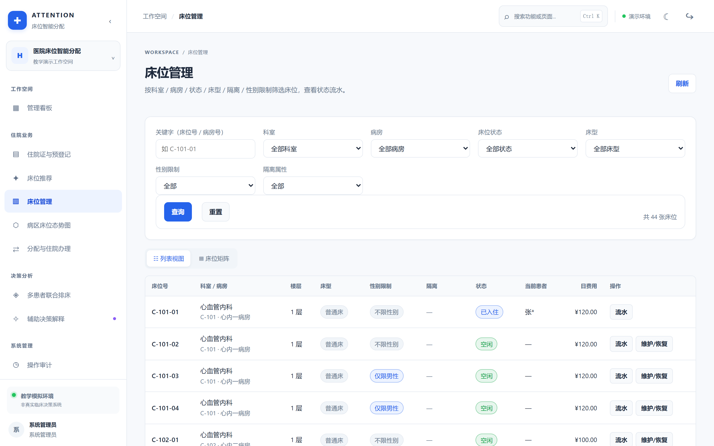
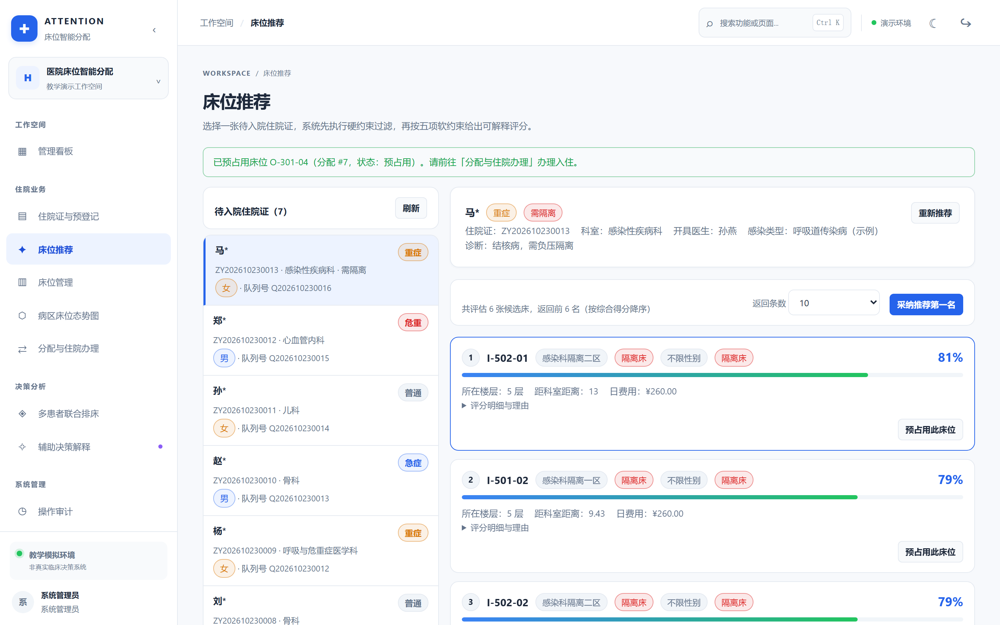
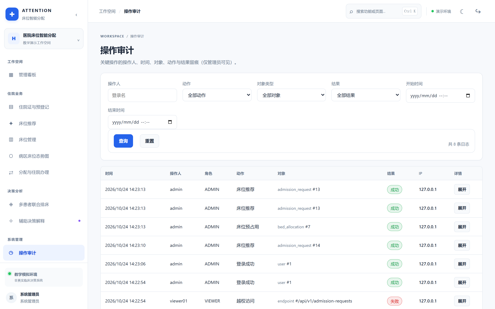
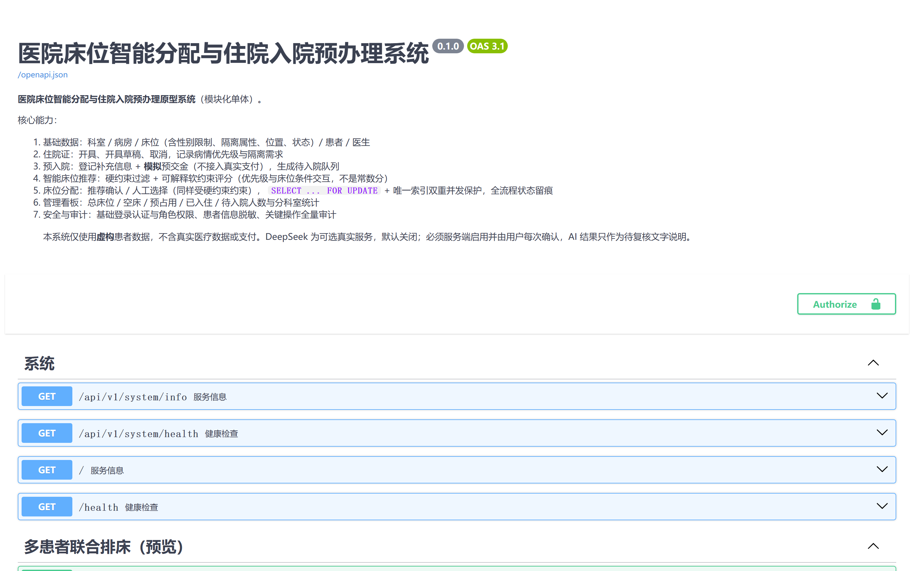
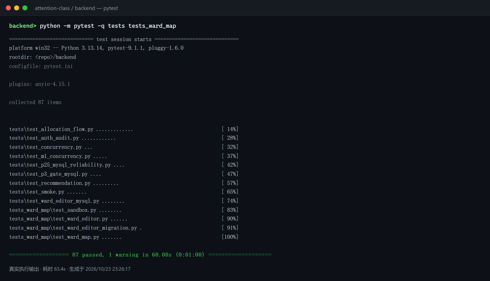

# 医院床位分配管理系统（attention-class）

基于 **FastAPI + Vue 3** 的医院床位分配管理系统（课程项目）：覆盖「开住院证 → 预入院登记 →
床位推荐 → 预占用 → 入住 → 出院 → 床位释放」的完整闭环，带 JWT 鉴权、角色权限、操作审计与
并发安全分配。

> 全部数据为**虚构演示数据**；**不接真实支付**（预交金为模拟记账）、**不调用付费大模型**
> （可选 DeepSeek 默认关闭），评分全部在本地确定性计算。



---

## 一、这个项目的「智能分配」是什么

**是基于规则的评分算法，不是深度学习，也不是大模型。** 逻辑分两步，全部可解释、可复现：

**第一步：硬约束过滤（一票否决）** —— `backend/app/services/bed_policy.py`

| 编号 | 规则 |
| --- | --- |
| H1 | 床位状态必须是「空闲」（已停用床位直接排除） |
| H2 | 床位科室必须与住院证科室一致 |
| H3 | 床位性别限制与患者性别不能冲突 |
| H4 | **隔离双向**：隔离患者只能进隔离床；隔离床也不向非隔离患者开放 |

不满足任一条件即不进入候选集；无候选时接口返回**具体原因**，不做"降级推荐"。

**第二步：软约束加权评分（0–100）** —— `backend/app/services/recommendation.py`

| 维度 | 权重 | 说明 |
| --- | --- | --- |
| 距离适配 | 0.32 | 护士站加权距离；**优先级越高越靠前**，轻症让出近端床位 |
| 优先级-床型适配 | 0.28 | 危重/重症与床型的匹配度，随优先级非线性上升 |
| 病房负载均衡 | 0.18 | 病房空床率越均衡得分越高，避免扎堆 |
| 成本适配 | 0.12 | 日费用越低越优 |
| 期望病房 | 0.10 | 住院证上填写的期望病房命中加分 |

每项都会返回 `raw_score / weight / contribution / note`，前端逐条展示中文理由，
面试时可以直接指着页面讲"为什么推荐这张床"。

**多患者联合排床**另外用贪心 + 最小费用流做对比实验（`/api/v1/optimizations/preview`，
只读、不写库），用来演示"逐个人分配"与"整体最优"的差距，同样不是机器学习。

## 二、技术栈

| 层次 | 选型 |
| --- | --- |
| 前端 | Vue 3 + TypeScript + Vite + Vue Router（无 UI 框架，自建设计令牌） |
| 后端 | FastAPI + SQLAlchemy 2.0 + Alembic + Pydantic v2 |
| 数据库 | MySQL 8（InnoDB，行锁 + 唯一索引做并发保护） |
| 鉴权 | JWT（HS256）+ 角色权限（admin / doctor / nurse / viewer） |
| 测试 | pytest（真实 MySQL 并发用例 + SQLite 行为用例） |
| 部署 | Docker Compose（MySQL + 后端 + nginx 静态前端） |

## 三、架构



**鉴权链路**：登录签发 JWT → 前端存 token 并在请求头带 `Authorization: Bearer <token>` →
后端依赖 `require_roles(...)` 校验角色 → 越权返回 `403 PERMISSION_DENIED` **并写入审计**。

**审计链路**：登录、开单、分配、入住、出院、释放、越权等写操作都在同一事务内落
`audit_logs`（操作人 / 角色 / 动作 / 对象 / 结果 / IP / UA），管理员可按时间范围检索。

## 四、一键启动

### 方式 A：Docker Compose（推荐，一条命令）

```bash
cp .env.example .env          # 填入 MYSQL_ROOT_PASSWORD / MYSQL_PASSWORD / SECRET_KEY
docker compose up -d --build
```

* 前端 <http://localhost:8080>｜后端文档 <http://localhost:8000/docs>
* 首次启动自动完成：建库 → Alembic 迁移 → **空库时自动写入演示数据** → 起服务。
  数据卷已有数据时不会重复写入（`AUTO_SEED=false` 可关闭）。

### 方式 B：本机直跑（改代码时用）

```bash
# 1) 准备 MySQL 8（任意实例，或用本仓库 sql/init/00_create_database.sql 建库建号）
# 2) 后端
cd backend
pip install -r requirements.txt
cp .env.example .env                    # 填 DATABASE_URL / TEST_DATABASE_URL / SECRET_KEY
python -m alembic upgrade head
python seed.py                          # 写入演示数据
python -m uvicorn app.main:app --reload --port 8000

# 3) 前端（另开终端）
cd frontend
npm install
npm run dev
```

* 管理后台 <http://127.0.0.1:5173/>｜Swagger <http://127.0.0.1:8000/docs>
* 前端开发服务器已把 `/api`、`/health`、`/docs`、`/openapi.json` 代理到 8000，无跨域问题。

## 五、演示账号

| 账号 | 口令 | 角色 | 能做什么 |
| --- | --- | --- | --- |
| `admin` | `admin123` | 管理员 | 全部权限 + 查看审计日志 + 患者明文 |
| `doctor01` | `doctor123` | 医生 | 开住院证、预入院登记、看推荐 |
| `nurse01` | `nurse123` | 护士 | 推荐、预占用、入住、出院、释放 |
| `viewer01` | `viewer123` | 只读 | 仅查看列表与看板 |

这些是**演示用固定账号**，通过 `python seed.py` 写入，非真实用户数据。

## 六、接口与文档

* 在线文档：`/docs`（Swagger UI，可直接 Authorize 后点调用）、`/redoc`、`/openapi.json`
* 接口总表：[API.md](API.md) —— 方法、路径、用途、鉴权，由 `scripts/gen_api_md.py` 从源码生成，
  共 **51 个端点**（OpenAPI 统计 44 路径 / 53 操作，含 2 个无前缀端点）
* 统一错误格式：`{ code, message, detail, request_id }`，便于前端按 `code` 分支处理

| 状态码 | 典型 code | 场景 |
| --- | --- | --- |
| 401 | `AUTH_TOKEN_INVALID` | 未带令牌 / 令牌过期 |
| 403 | `PERMISSION_DENIED` | 角色不足（同时写审计） |
| 409 | `ILLEGAL_STATE_TRANSITION` / `BED_NOT_AVAILABLE` / `REQUEST_ALREADY_ALLOCATED` | 状态机非法流转 / 并发抢床 / 重复分配 |
| 422 | `HARD_CONSTRAINT_VIOLATION` / `VALIDATION_ERROR` | 违反 H1–H4 硬约束（返回具体违反项）或请求体校验失败 |

## 七、测试

```bash
cd backend
python -m pytest -q tests tests_ward_map                      # 主套件（真实 MySQL）
python -m pytest -q tests_m1_local tests_p1p2 tests_p15 tests_p25   # SQLite 行为套件
```

**当前结果：`87 passed` + `75 passed` = 162 项全通过**（MySQL 8.0，耗时约 60s / 15s）。

| 套件 | 用例 | 覆盖点 |
| --- | --- | --- |
| `tests/test_allocation_flow.py` | 13 | 人工选床、采纳推荐、科室/性别/隔离冲突、4 类非法流转、出入院闭环、取消回滚 |
| `tests/test_auth_audit.py` | 12 | 登录成功/失败留痕、非法令牌、越权 403 与审计、脱敏与明文权限 |
| `tests/test_concurrency.py` + `test_m1_concurrency.py` | 8 | **两线程抢同一张床**（恰好一成功）、唯一索引兜底、幂等键并发重放 |
| `tests/test_p25_mysql_reliability.py` | 4 | 并发换床至多一个成功、绕过服务直写被唯一索引拒绝 |
| `tests/test_recommendation.py` | 9 | 普通/隔离/性别/无空床场景、优先级非线性验证 |
| `tests/test_smoke.py` | 7 | 健康检查、OpenAPI、迁移版本、统一错误 |
| `tests/test_p3_gate_mysql.py` | 4 | 三维沙盘只读性与权限闸门 |
| `tests/test_ward_editor_mysql.py` + `tests_ward_map/` | 22 | 床位增删改、槽位约束、沙盘复用正式评分 |
| `tests_m1_local` / `tests_p1p2` / `tests_p15` / `tests_p25` | 75 | 状态机顺序与回滚、优化器、合成实验、故障注入（SQLite，无需 MySQL） |

`tests/conftest.py` 有 **fail-closed 守卫**：`TEST_DATABASE_URL` 不是 `*_test` 库名就直接拒绝，
避免误删演示库；测试库每次由 Alembic 从零建表，等于顺带验证迁移脚本。

## 八、截图

| | |
| --- | --- |
|  |  |
| 登录（演示账号一键填充） | 床位管理（44 张床，多条件筛选） |
|  |  |
| 推荐 + 预占用成功（五项评分明细） | 操作审计（含越权失败记录） |
|  |  |
| Swagger /docs | pytest 全通过 |

截图由 `scripts/demo_screenshots.mjs`、`scripts/pytest_shot.mjs` 自动生成，可复跑。

## 九、目录结构

```
.
├── backend/                 FastAPI 后端
│   ├── app/api/v1/          路由（认证、住院证、推荐、分配、看板、审计、沙盘）
│   ├── app/core/            配置、JWT/口令散列、统一错误、脱敏
│   ├── app/models/          SQLAlchemy 模型与状态枚举
│   ├── app/services/        推荐算法、分配事务、审计、硬约束策略
│   ├── alembic/             数据库迁移（表结构唯一变更入口）
│   ├── tests/ tests_* /     pytest 套件
│   ├── seed.py              演示数据
│   ├── Dockerfile
│   └── docker-entrypoint.sh 迁移 + 空库自动 seed + 起服务
├── frontend/                Vue 3 + TS 前端
│   ├── src/{api,views,layouts,router,styles}/
│   ├── nginx.conf  Dockerfile
├── docker/mysql/init/       容器首次初始化脚本（建测试库）
├── scripts/                 API.md 生成、截图、实验基准
├── docs/                    架构、E-R 图、业务流程、算法与策略说明
└── docker-compose.yml
```

## 十、已知限制

* 表结构、状态机取值、评分权重均为**待业务方确认的原型草案**，不是临床结论。
* 未接真实 HIS / 支付 / 短信；未做压测（单科室数十张床位的规模不需要）。
* 三维病区态势图的空间坐标是**模拟排布**（非 BIM 图纸），只影响展示，不影响评分。
* Docker 编排文件已通过 `docker compose config` 静态校验，并在容器内验证过启动脚本的
  seed 判定分支；**尚未在完整 Docker 环境下跑通端到端**（开发机沙箱禁用 WSL），
  首次使用时如遇镜像拉取或端口占用，请按 `docker compose logs` 排查。

## 十一、文档索引

| 文档 | 内容 |
| --- | --- |
| [API.md](API.md) | 接口总表（源码生成） |
| [POLISH.md](POLISH.md) | 本次工程化整理做了什么、修过什么问题、残留风险 |
| [docs/architecture.md](docs/architecture.md) | 分层与关键设计决策 |
| [docs/er-diagram.md](docs/er-diagram.md) | E-R 图与索引/状态约束 |
| [docs/business-flow.md](docs/business-flow.md) | 业务流程图、状态机、权限矩阵 |
| [docs/recommendation-algorithm.md](docs/recommendation-algorithm.md) | 评分算法细节与为什么这样定权重 |
| [docs/isolation-bed-policy.md](docs/isolation-bed-policy.md) | 隔离床双向策略 |
