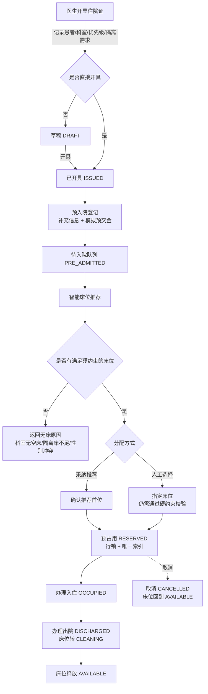
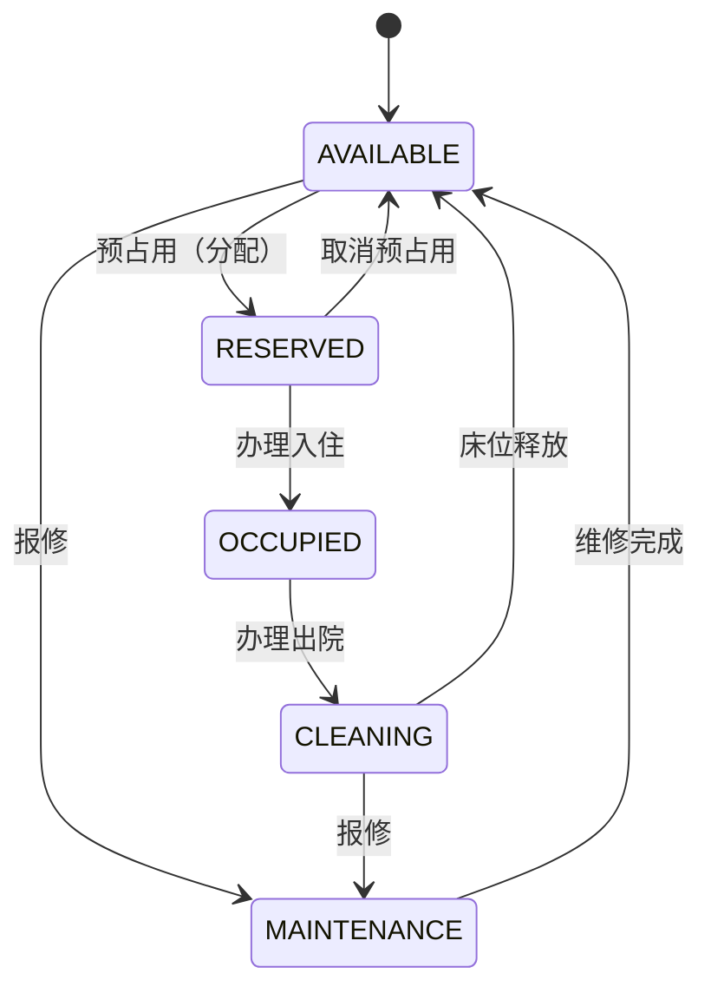

# 业务流程

## 主流程



## 状态流转时序

```mermaid
sequenceDiagram
    autonumber
    participant D as 医生
    participant N as 护士/管理员
    participant API as FastAPI
    participant DB as MySQL

    D->>API: POST /admission-requests（开具住院证）
    API->>DB: INSERT admission_requests（ISSUED）
    N->>API: POST /admission-requests/{id}/preadmission
    API->>DB: INSERT preadmissions + status=PRE_ADMITTED
    N->>API: GET /admission-requests/{id}/bed-recommendations
    API->>DB: SELECT 床位（硬约束过滤）+ 软约束评分
    API-->>N: 排序结果 + 分数明细 + 推荐理由
    N->>API: POST /allocations（bed_id 可空）
    API->>DB: BEGIN; SELECT ... FOR UPDATE
    API->>DB: INSERT bed_allocations(active_bed_id=bed); UPDATE beds SET status=RESERVED
    API->>DB: INSERT bed_status_logs + audit_logs; COMMIT
    API-->>N: 201 分配记录
    N->>API: POST /allocations/{id}/admit
    API->>DB: status=ADMITTED / beds.status=OCCUPIED
    N->>API: POST /allocations/{id}/discharge
    API->>DB: status=DISCHARGED / beds.status=CLEANING
    N->>API: POST /beds/{bed_id}/release
    API->>DB: beds.status=AVAILABLE
```

## 床位状态机



任何不在此图中的流转都会返回 `409 ILLEGAL_STATE_TRANSITION`。

## 角色与权限矩阵

| 操作 | ADMIN | DOCTOR | NURSE | VIEWER |
| --- | :---: | :---: | :---: | :---: |
| 登录 / 查看看板 / 查看列表 | ✅ | ✅ | ✅ | ✅ |
| 开具住院证 | ✅ | ✅ | — | — |
| 预入院登记 | ✅ | ✅ | ✅ | — |
| 查看床位推荐 | ✅ | ✅ | ✅ | ✅ |
| 预占用 / 入住 / 出院 / 释放 | ✅ | — | ✅ | — |
| 基础数据维护（科室/病房/床位/医生） | ✅ | — | — | — |
| 新增/修改患者 | ✅ | — | ✅ | — |
| 查看患者明文信息 | ✅ | — | — | — |
| 查看审计日志 | ✅ | — | — | — |

越权访问返回 `403 PERMISSION_DENIED`，并写入一条 `result=FAILURE` 的审计记录。
