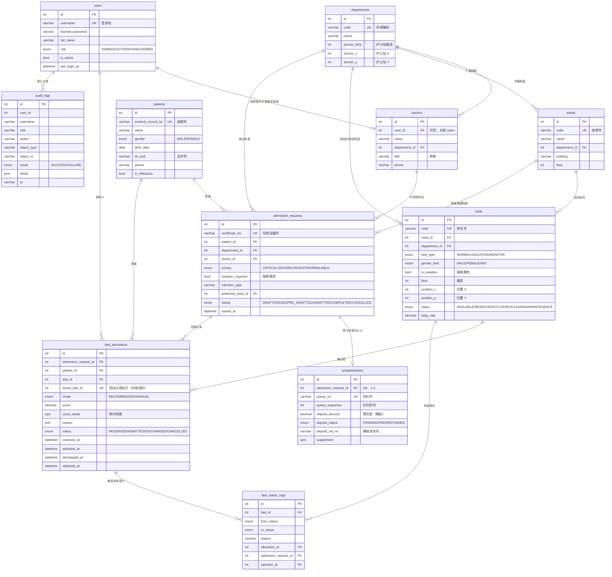

# E-R 图

> 下表为**原型草案**，用于跑通端到端演示；正式业务表结构待设计确认后定稿。

## 实体关系图（Mermaid）



## 索引设计

| 表 | 索引 | 目的 |
| --- | --- | --- |
| `beds` | `ix_beds_dept_status(department_id, status)` | 推荐时按科室 + 状态过滤 |
| `beds` | `ix_beds_status_isolation(status, is_isolation)` | 隔离床可用量统计 |
| `beds` | `ix_beds_ward_status(ward_id, status)` | 病房负载（空床率）计算 |
| `admission_requests` | `ix_admission_requests_dept_status` / `ix_admission_requests_priority` | 队列与看板筛选 |
| `bed_allocations` | `UNIQUE(active_bed_id)` | **并发防重复占用（核心）** |
| `bed_allocations` | `ix_allocations_status_time` | 分配记录列表与统计 |
| `bed_status_logs` | `ix_bed_status_logs_bed_time` | 床位流转时间线 |
| `audit_logs` | `ix_audit_logs_created` / `_user` / `_action` / `_object` | 审计检索 |

## 状态约束

| 对象 | 取值 | 合法流转 |
| --- | --- | --- |
| 床位 `beds.status` | AVAILABLE / RESERVED / OCCUPIED / CLEANING / MAINTENANCE | AVAILABLE→RESERVED\|MAINTENANCE；RESERVED→OCCUPIED\|AVAILABLE；OCCUPIED→CLEANING；CLEANING→AVAILABLE\|MAINTENANCE；MAINTENANCE→AVAILABLE |
| 住院证 `admission_requests.status` | DRAFT / ISSUED / PRE_ADMITTED / ADMITTED / COMPLETED / CANCELLED | DRAFT→ISSUED\|CANCELLED；ISSUED→PRE_ADMITTED\|CANCELLED；PRE_ADMITTED→ADMITTED\|CANCELLED；ADMITTED→COMPLETED |
| 分配 `bed_allocations.status` | RESERVED / ADMITTED / DISCHARGED / CANCELLED | RESERVED→ADMITTED\|CANCELLED；ADMITTED→DISCHARGED |

数据库级约束（MySQL 8.0.16+ 生效）：

```sql
CONSTRAINT ck_beds_isolation_consistent CHECK (
  (bed_type = 'ISOLATION' AND is_isolation = 1)
  OR (bed_type <> 'ISOLATION' AND is_isolation = 0)
);
```

约束在业务层通过 `BED_STATUS_TRANSITIONS` / `ADMISSION_REQUEST_TRANSITIONS` /
`ALLOCATION_TRANSITIONS` 三张流转表集中校验，非法流转统一返回
`409 ILLEGAL_STATE_TRANSITION`。

## 并发防重复占用

`bed_allocations.active_bed_id` 在分配处于 `RESERVED` / `ADMITTED` 时写入被占用床位 ID，
其余状态写 `NULL`。MySQL 唯一索引允许多个 `NULL`，因此：

* 同一床位最多只能存在一条活动占用记录 → 数据库层面拒绝重复占用；
* 历史记录不受影响，可无限累积。

配合业务层的 `SELECT ... FOR UPDATE` 行级锁，形成双重保护。
